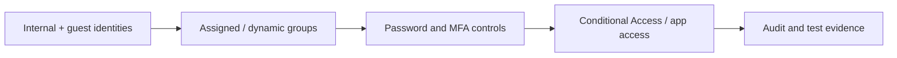

# Microsoft Security — Entra ID & Cloud Security Labs

**Identity administration · MFA · Conditional Access · Guest access · Password protection · Security controls**

Practical Microsoft Entra ID security configurations performed in a Microsoft 365 Business Premium educational tenant for the fictional organization **ExposedCybersecurity**.

The portfolio documents real tenant administration in a lab context, with configuration screenshots, decision-making and test results. It does not imply production responsibility for a customer organization.

## Featured result — Microsoft Applied Skills

**Get started with identities and access using Microsoft Entra**  
Completed 3 September 2026 · **100% assessment result** (as recorded in the original lab documentation).

[View credential (PDF)](01-Identity-and-Access/Microsoft%20Applied%20Skills%20Entra.pdf) · [Complete Entra IAM lab series](01-Identity-and-Access/README.md)

## Implemented IAM controls

| Lab | Problem and control | Validation |
|---|---|---|
| [01 · Group Management](01-Identity-and-Access/01-Basic-Group-Management/README.md) | Manual and dynamic groups, B2B guest invitation, ownership and group licensing | Dynamic guest membership processing and group assignment reviewed |
| [02 · Password Protection](01-Identity-and-Access/02-Basic-Password-Protection/README.md) | Smart Lockout, weak-password restrictions and banned-password policy | Configured and documented in the Entra lab |
| [03 · Self-Service Password Reset](01-Identity-and-Access/03-Self-Service-Password-Reset/README.md) | Recovery and registration settings for scoped users | SSPR configuration and notifications recorded |
| [04 · MFA & Authentication Methods](01-Identity-and-Access/04-Multifactor-Authentication/README.md) | Legacy vs current MFA, app-password restriction, suspicious activity reporting | Tested training configuration, then restored legacy per-user MFA state |
| [05 · Conditional Access](01-Identity-and-Access/05-Conditional-Access/README.md) | User- and app-scoped access restriction with safe rollout | **Report-only** policy and **What If** evaluation; live blocking was **not** enforced |

### Conditional Access — evidence example

*The test showed that the specified policy would apply. It was not switched into enforcement mode.*

## Lab architecture and control sequence

This illustrates the progression of implemented lab topics, **not** a complete enterprise architecture or an automated end-to-end identity lifecycle.

## Notable technical decisions

- Used a fictional company instead of reproducing Contoso without adaptation.
- Evaluated modern Authentication Methods settings when older training material referred to legacy MFA controls.
- Avoided Security Questions in the recovery design.
- Left Trusted IP MFA bypass disabled.
- Practised Conditional Access in **Report-only** before enforcing any rule.
- Excluded the admin test account from the narrowly scoped example policy while reviewing lockout risk.
- Documented what was configured, what was simulated and what remains for subsequent work.

## Next engineering work

Identity lifecycle automation, advanced Conditional Access, PIM, access reviews, federated applications, Microsoft Graph scripting, Microsoft Defender and Purview are **planned**, not represented as completed work here.

## Related work

[TryHackMe Microsoft Entra learning series](https://github.com/artiomcyber/TryHackMe/tree/main/MS-Entra-ID) · [GRC projects](https://github.com/artiomcyber/grc-projects) · [Forage security simulations](https://github.com/artiomcyber/forage-cybersecurity-projects) · [GitHub profile](https://github.com/artiomcyber)

For configuration details and all lab screenshots, use the [Entra IAM index](01-Identity-and-Access/README.md).
